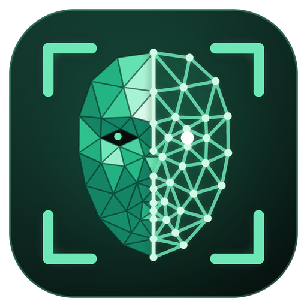

# Face Recognizer

<p align="center">
  
</p>

Local face recognition for any camera stream. It learns specific people from your photo library, lets you name
or ignore faces in a labeling tool, and shows names with match confidence, and optionally what a face looks
like, on faces live. Several devices can work as one: they share names and labels through a database you host
yourself, and show each other their cameras and original photos over your local network.

Everything runs on your own computers. Nothing leaves them unless you send it on purpose
([what reaches the network](docs/SETTINGS.md), [privacy policy](PRIVACY.md)).

Written in Rust: one codebase for Windows, macOS, Linux, the Raspberry Pi, iPhone and Android.

## Why we did this

Many systems that claim to read people run a classifier on single pictures, print a label, and send the
pictures to someone else's computers. We wanted to know something harder and more honest: how a particular
person responds to the people, the music and the events around them.

That takes four things we had not seen put together:

- **The response in its parts.** What a person shows, what their voice and body do, and what they say they
  feel are tied together more loosely than is usually assumed, and differently for each person. So each is
  measured on its own, for an identified person, on one clock, and none is taken for another.
- **Each person as their own measure.** A reading means something only against that person's own normal.
- **Proof before belief.** Every signal is a hypothesis until it has been measured on the person it is
  about. The app says what a face looks like and how sure it is, and never what someone feels.
- **Your people stay yours.** Recognizing the people who matter to you is as private as data gets. So it
  runs on your own devices, which work together as equals, and nothing leaves them.

New work is easy to do carelessly, and work done carelessly does not last. This was built to last: measured,
private, and our own. That is also why, from version 2.4.0, it is a commercial product under its own
[licence](#licence): the methods are original, and we mean to stand behind them and go on building.

## What is new here

This is original research and engineering by Singularity Research, not a wrapper around an existing product.
It builds on published work, which the [references](docs/REFERENCES.md) name one by one; what follows is the
project's own. To our knowledge no other system puts these together, and we regard them as inventions.

- **A cluster with no master.** Every device is an equal node. Each publishes one self-describing document
  of itself (what it is, every sensor it has, what is switched on and off, its settings and its live
  readings), and any other device of yours subscribes to it directly: the whole document first, then every
  change as it happens. Both sides prove who they are with their own certificate, and no server sits between
  them. (Names, labels and prints still travel through the shared database you host; they are moving onto
  the same footing, after which no single machine has to be up.)
- **Joining by a code that holds no secret.** Any member lets a new device in: one shows a code, the other
  reads it, either way round. What is handed over crosses your network encrypted for that one exchange.
- **Each person measured against themselves.** Every signal (face, voice, body, pulse, breathing) is read
  against that person's own usual range, learned for them alone and in company. "Unusual" means unusual for
  them, never against an average of other people.
- **A reading in layers, with its evidence.** What a face looks like is kept apart from any claim about what
  a person feels. Each reading carries what it rests on (votes, share, picture quality, head turn), and a
  part that could change the reading stays off until it has been measured.
- **Every channel on one clock, for each identified person.** Face, voice, body, the room's sound, music and
  the device's own state are taken at the device's full rate, each reading with its own time, so they can be
  set side by side across devices.
- **Recognition that holds on poor pictures.** A live name comes from several pictures' prints averaged by
  their quality, and the recognizer (Opsis 1, the project's own) is trained to give a poor picture of a face
  the print of a good one.
- **The same face, the same identity, on every system.** Photos and videos decode to the same bytes on
  Windows, macOS, Linux and the Raspberry Pi, so a face found on one computer is the same face, under the
  same permanent ID, on all of them.
- **Measured, not assumed.** Thresholds are measured values, a faster path has to give the slower path's
  answers, and what has not been measured is shown as evidence only and says so.

## What it does

- **Face tracking**: names on the faces a camera sees, with how sure the match is; alerts when someone arrives,
  leaves or moves between cameras; optional reading of expression, posture, voice and the room's sound, as
  numbers only. **Signals** charts every one of those readings over the last minutes, as fast as the device
  takes them, one expander a section.
- **Labeling**: add photos and videos, name the faces found in them or ignore them, with clues (closest people,
  photo tags, same occasion) and Undo. A person's data can be exported or forgotten everywhere.
- **Cameras**: every device's live camera in one grid, with what each sees and its Signals chart; any one of
  them alone, laid out like its own Face tracking tab.
- **Where each device is** (off until you switch it on, device by device): the nearest town with its state and
  country and the coordinates, on the device's own Face tracking tab and over its picture in the Cameras tab,
  from the device's own location service or a place you type; with a shared database, a history of its moves
  for 90 days (or the days you set). The towns' names come from a list inside the app, so nothing is looked up
  on the internet.
- **A history of every signal** (off until you switch it on, device by device; needs a shared database): what
  a device reads is kept for analysis, a row every 10 seconds for the device and for each named person in view,
  each signal as its average, lowest and highest, for as many days as you set. Your photos and videos can be
  added to it: what each says of the people named in it, at the picture's own time. It is written beside the
  rest of the app, a second or two after each row is finished, and nothing else depends on it.
- **Describe photo**: a vision model on your own computer describes a photo and reads its text: through LM Studio,
  Ollama, llama.cpp or vLLM, or the built-in model. Settings suggests the model and settings for the computer's
  own graphics memory and loads it, and Describe all can share its photos with your other computers' servers.
  [What runs best where](docs/MODELS_AND_HARDWARE.md) has the measurements behind it, for five computers and four
  servers, with the app's own models, Opsis 1 and Melos 1. In short:
  - A Mac Studio (M5 Ultra) describes a photo in under a second.
  - The Radeon 8060S PCs take about 3 s with the most detailed model, Qwen 3.6 35B-A3B.
  - The 8 GB laptops are fastest with Gemma 4 E4B, under a second.
- **Shared database** (optional): PostgreSQL with pgvector on a server of your own, over TLS; keys are encrypted
  on the device before they go there. A new phone or computer joins by a code: one device shows it, the other
  scans it (**Join a new device** in Face tracking → Controls), either way round.
- **Device to device**: your devices publish to each other directly what each has, what is switched on, its
  settings and its readings, and keep their own list of members, so they go on finding each other while the
  shared database can't be reached.

## Install

Download the file for your computer from the [latest release](../../releases/latest):

| Computer | File |
|---|---|
| Windows 10 or 11 (64-bit) | `FaceRecognizer-Setup-x64.exe` |
| Mac with Apple Silicon, macOS 14 or later | `FaceRecognizer-macos-arm64.dmg` |
| Linux (x86-64, Ubuntu 22.04 or later) | `FaceRecognizer-linux-x64.run` (`sh FaceRecognizer-linux-x64.run`) |
| Raspberry Pi 4 or 5 with a 64-bit system | `FaceRecognizer-raspberrypi-arm64.run` |
| Android phone (64-bit ARM, Android 8 or later) | `FaceRecognizer-android-arm64.apk`: the tracker as an app; it joins your shared database by scanning a code another device shows |

No administrator rights are needed. The installers bring what the app runs with; nothing has to be installed
beforehand. At its first start the app asks before it downloads the face models (79 MB), each file checked by
its size and SHA-256. An update or uninstall never touches your models or your data.

The app has a window of its own on every system. On Windows and on a Mac it is the system's own web view; on
Linux and the Raspberry Pi it is a Chromium window (Chromium, Chrome, Edge or Brave: Raspberry Pi OS brings
Chromium). Where a Linux computer has none of them, the app opens in the default browser and says so.

## Build from source

Building your own copy needs a licence from Singularity Research ([Licence](#licence)). With one:

```
cargo build --release
cargo run -p face-tools --release -- get --root target/root    # the models and what the programs run with
cargo test --workspace --release
```

The app is `target/release/FaceRecognizer`. The installers are made by `packaging/windows/build.ps1`,
`packaging/macos/build.sh` and `packaging/linux/build.sh`. [CONTRIBUTING.md](CONTRIBUTING.md) has the rest.

## Layout

| Folder | What is in it |
|---|---|
| `crates/` | the libraries: recognition core, library and labeling, import, sync, the three local servers |
| `apps/` | the desktop app, and the tracker as an app for Android and iPhone |
| `web/` | the pages the app shows |
| `migrations/` | the shared database's schema |
| `packaging/` | the installers for each system |
| `docs/` | settings, the reasoning behind the expression reading, the [research this work builds on](docs/REFERENCES.md), [models and hardware measured](docs/MODELS_AND_HARDWARE.md), and the stores' listings |

## Licence

Face Recognizer is a commercial, proprietary product whose source is public. From version 2.4.0 it is under the
[Singularity Research Commercial License](LICENSE). You may read the source, and you may install and use the
apps Singularity Research publishes itself, in the stores and as this project's releases, on the terms shown
where you get them. Anything else needs a written licence from Singularity Research: building your own copy,
changing it, using any part of it in other software, or passing it on.

The models the app downloads that are other people's have licences of their own, each of which allows
commercial use; the face recognizer and the voice model are the project's own. See [NOTICE](NOTICE).

The methods described under [What is new here](#what-is-new-here) are inventions of Singularity Research. All
patent rights in them are reserved: publishing the source grants no licence to any patent beyond what the
licence of the version you hold says itself.
