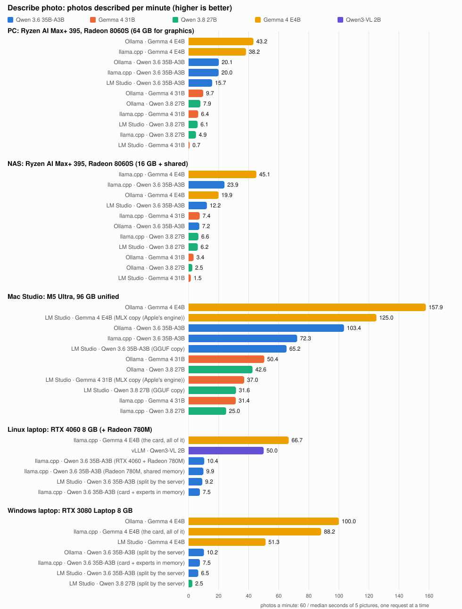
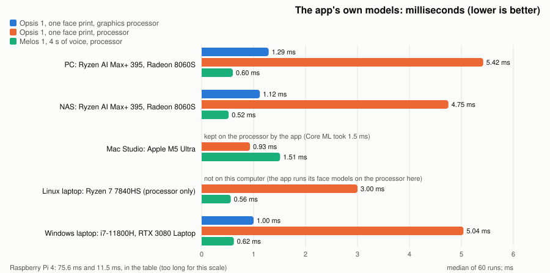

# Models and hardware: what runs best where

Measured on 25 November 2026 on five computers of the project, with the app's own requests (the app's own models
also on a Raspberry Pi 4). This is the evidence
behind what Settings suggests for Describe photo (Labeling: Describe photo, **Suggested for this computer**), and
the numbers for the app's own two models, Opsis 1 and Melos 1.

## The computers

| Computer | Processor | Graphics | Memory a model can use |
|---|---|---|---|
| PC (Windows 11) | AMD Ryzen AI Max+ 395 | Radeon 8060S, built in | 64 GB set aside for graphics, of 128 GB |
| NAS (Windows 11) | AMD Ryzen AI Max+ 395 | Radeon 8060S, built in | 16 GB set aside, plus shared memory (64 GB in all) |
| Mac Studio (macOS 27) | Apple M5 Ultra | built in | 96 GB unified |
| Linux laptop (Ubuntu) | AMD Ryzen 7 7840HS | NVIDIA RTX 4060 Laptop, 8 GB; and a Radeon 780M built in | 8 GB on the card, 61 GB memory |
| Windows laptop (Windows 11) | Intel Core i7-11800H | NVIDIA RTX 3080 Laptop, 8 GB | 8 GB on the card, 32 GB memory |

The app's own models were timed on a Raspberry Pi 4 as well, which has no graphics processor the app uses; it
runs no describe server.

## Describe photo: servers and models

### How it was measured

- **The request** is the app's own (Describe photo: the same prompt, a temperature of 0.2, at most 400 words of
  answer, reasoning switched off in the way each server takes it), one request at a time.
- **The pictures** are five made-up ones, each sent as the app sends a photo (at most 1024 px, JPEG): three drawn
  scenes with printed text (a park sign, a birthday banner, a café menu), a frame of a generated face at a desk,
  and a screenshot of the app with made-up people. No photo of a real person was used.
- **The numbers** are the median of the five, after one warm-up request. Photos a minute is 60 divided by that.
- **The settings** are the same everywhere: a 4,096-token context (a photo's request is 350 to 770 tokens and the
  answer at most 400), every layer on the graphics processor where the model fits, and one request at a time.
  Where it doesn't fit, the server split it with main memory (Ollama, LM Studio), or llama.cpp kept a mixture of
  experts' experts in memory (`--n-cpu-moe`).
- **The servers:** LM Studio (with its own engine for each computer: llama.cpp with ROCm on the Radeon PCs,
  llama.cpp or Apple's MLX on the Mac), Ollama 0.40.16 to 0.40.18, llama.cpp build b12703 (Vulkan on the Radeons
  and the Linux laptop, CUDA on the Windows laptop, Metal on the Mac) and vLLM 0.34.0.
- **The models** are 4-bit copies (Q4_K_M, or MLX 4-bit in LM Studio on the Mac):
  - Qwen 3.6 35B-A3B: a mixture of experts that uses 3 of its 35 billion parameters for each word;
  - Gemma 4 31B and Qwen 3.8 27B: dense;
  - Gemma 4 E4B: small.

  All of them read pictures, and all are under the Apache 2.0 licence.

<picture>
  <source media="(prefers-color-scheme: dark)" srcset="images/describe-models-dark.svg">
  
</picture>

### What the answers were like

Every model on every server answered every picture in the app's form (two or three sentences, then a `Text:` line),
and every one of them read every word of the three signs. They differ in how much they say:

- **Qwen 3.6 35B-A3B** gives the fullest descriptions, for example "a menu board for Café Roma, listing coffee
  drinks, an almond croissant and a daily soup with prices".
- **Qwen 3.8 27B** is as detailed, at a third of Qwen 3.6's speed or less.
- **Gemma 4 31B** and **Gemma 4 E4B** are accurate and short ("a menu board at a cafe; no people in the image"),
  with the text read exactly.
- **Qwen3-VL 2B** is the small model that vLLM could hold on an 8 GB card. It wrote `Text: none` under three
  pictures whose text it had just described, so it is not one of the suggested models.

### What runs best on each computer

| Computer | Fastest | Best detail | Notes |
|---|---|---|---|
| Mac Studio | Gemma 4 E4B, Ollama: 0.4 s | Qwen 3.6 35B-A3B, Ollama: 0.6 s | Everything is fast here; Gemma 4 31B 1.2 s. Ollama was the quickest server for every model; LM Studio's MLX copies came close. |
| PC | Gemma 4 E4B, Ollama: 1.4 s | Qwen 3.6 35B-A3B, Ollama or llama.cpp: 3.0 s | LM Studio's ROCm engine took 87 s a picture with Gemma 4 31B, most likely in its picture part: use Ollama or llama.cpp for Gemma here. |
| NAS | Gemma 4 E4B, llama.cpp: 1.3 s | Qwen 3.6 35B-A3B, llama.cpp: 2.5 s | Only 16 GB are the graphics processor's own: llama.cpp makes the most of the shared memory, Ollama the least. |
| Windows laptop | Gemma 4 E4B, Ollama: 0.6 s | Qwen 3.6 35B-A3B, Ollama: 5.9 s | Gemma 4 E4B fits the 8 GB card whole (4.3 GB) and is the one to use. |
| Linux laptop | Gemma 4 E4B, llama.cpp: 0.9 s | Qwen 3.6 35B-A3B on both graphics processors: 5.8 s | The built-in Radeon 780M with shared memory ran Qwen 3.6 as fast as the RTX 4060 with its experts in memory. vLLM held only a 2-billion model. |

Rules that follow from these, and that **Suggested for this computer** applies:

- **A model that fits wholly on the graphics processor comes first.** Its size there was measured, with its picture
  part and a 4,096 context: Qwen 3.6 35B-A3B 21.4 GB, Gemma 4 31B 21.3 GB, Qwen 3.8 27B 19.2 GB, Gemma 4 E4B 4.3 GB.
  On the big machines that is Qwen 3.6 35B-A3B (best detail at 3 s or less), and on 8 GB cards Gemma 4 E4B
  (under a second).
- **A server that has only a mixture of experts too big for its card keeps the experts in memory.** Qwen 3.6
  35B-A3B then needs 3.1 GB on the card and ran at 6 to 9 s a picture on both 8 GB laptops. A dense model split
  the same way is slow: Qwen 3.8 27B took 24 s on the Windows laptop.
- **vLLM needs the whole model on an NVIDIA card, on Linux.** It put its 4-bit copies on the card whole whatever
  share was meant to stay in memory, and it reserves room for the largest picture a model could take. Gemma 4 31B
  and Gemma 4 E4B both ran out of the 8 GB card. On these computers vLLM suits none of the models: Settings says
  so, and suggests LM Studio, Ollama or llama.cpp instead.
- **What a server already has comes before a model to get.** Settings never downloads a model by itself; it names
  the better one to get.

### Sharing Describe all

Describe all can share its photos with your other computers' servers (Settings, **Share Describe all with other
computers**): each computer takes the next photo when it has finished one.

| Servers | Computers | Photos | Photos a minute | Each computer's part |
|---|---|---|---|---|
| llama.cpp, Qwen 3.6 35B-A3B | PC + Linux laptop | 32 in 90 s | 21 | PC 23, Linux laptop 9 |
| LM Studio, Qwen 3.6 35B-A3B | PC + Mac Studio + NAS + Linux laptop | 237 in 180 s | 79 | Mac Studio 165, PC 30, NAS 24, Linux laptop 18 |
| LM Studio, Qwen 3.6 35B-A3B (again, 120 s) | the same four | 135 in 120 s | 68 | Mac Studio 90, PC 17, Linux laptop 17, NAS 11 |

These used real photos of the owner's library, read from disk and shrunk on the PC. Each computer's part follows
its own speed, and the fastest one does most of the work: here the Mac Studio, which on its own describes 65 to 100
photos a minute.

Sharing works with every kind of server. LM Studio's servers are found on the network; the other kinds are asked
at each device's addresses, from the shared database, on their usual port. Every helper must be the same kind of
server as the configured one and have the same model, so that every description comes from the same model.

## The app's own models

### Opsis 1: face recognition

Opsis 1 makes the print of a face (128 numbers) from the 112×112 picture of it. It was trained by the project from
OpenCV Zoo's SFace (Apache 2.0), to give a poor picture of a face the print of a good one.

**How well it recognizes.** The figures below are for its training recipe, measured on the owner's library:

- **The method:** four-way cross-validation on 940 faces of 134 people. Each quarter was measured with a model
  trained without that quarter's people.
- **How a face is scored:** looked up among the others, at the app's match setting.
- **The worse pictures:** the same faces made worse as a webcam makes them (blurred, tiny, moved).

| Pictures | Opsis 1's recipe: named correctly | SFace (its start) |
|---|---:|---:|
| clean | 81.1 % | 84.3 % |
| blurred | 64.7 % | 60.0 % |
| tiny | 58.3 % | 53.2 % |
| moving | 36.4 % | 8.1 % |
| how far apart it keeps people (d′) | 2.57 | 2.51 |

At its setting it named no clean face as the wrong person, and no stranger as anyone: what it does not know, it
leaves Unknown. It is slightly below SFace on clean pictures and well above it on poor ones, which is what a camera
gives. The released model was then trained on all the people.

### Melos 1: how a voice sounds

Melos 1 reads arousal, dominance and valence from a stretch of speech. It was trained by the project on what
listeners heard in the clips of CREMA-D (Open Database License).

**How well it agrees with listeners.** Measured on the fifth of CREMA-D's actors that its training never heard,
as concordance with the listeners' ratings (1 is the same):

| Reading | Agreement (CCC) |
|---|---:|
| arousal | 0.82 |
| dominance | 0.75 |
| valence | 0.64 |

These are acted voices, so the readings are evidence, not what a person feels.

### Their speed on each computer

Measured with the project's own `steps` tool (`crates/face-core/examples/steps.rs`): the same made-up frame (one
face, 1024×576), the median of 60 runs, on the graphics processor as the app chooses it and on the processor alone.
Melos 1 always runs on the processor; it was timed on four seconds of a made-up, voice-like sound.

<picture>
  <source media="(prefers-color-scheme: dark)" srcset="images/own-models-dark.svg">
  
</picture>

| Computer | Opsis 1, graphics | Opsis 1, processor | Melos 1, 4 s of voice | A whole frame, graphics | A whole frame, processor |
|---|---:|---:|---:|---:|---:|
| PC | 1.29 ms | 5.42 ms | 0.60 ms | 17.1 ms | 23.1 ms |
| NAS | 1.12 ms | 4.75 ms | 0.52 ms | 13.9 ms | 20.2 ms |
| Mac Studio | (processor: Core ML took 1.5 ms) | 0.93 ms | 1.51 ms | 18.8 ms | 26.0 ms |
| Windows laptop | 1.00 ms | 5.04 ms | 0.62 ms | 12.0 ms | 24.8 ms |
| Linux laptop | (processor only) | 3.00 ms | 0.56 ms | | 11.6 ms |
| Raspberry Pi 4 | (processor only) | 75.6 ms | 11.5 ms | | 241 ms |

"A whole frame" is finding the faces, then for each one its print, its quality and its expression; "graphics" is
the app's own choice of device for each model. On the Mac Studio the app keeps Opsis 1 on the processor, which
is quicker there than Apple's Core ML, and runs only the expression model on the graphics processor. The Raspberry
Pi was timed with its app stopped; it is in the table and not the chart, whose scale its numbers don't fit.

Both models are small next to what they serve: a face's print takes about a millisecond on a graphics processor
or an Apple processor, and a voice reading under two. A camera's frame costs 12 to 26 ms in all on the five
computers, so the app's own models are never what limits their checks a second. On a Raspberry Pi 4 a print
takes 76 ms, about a third of a frame's 241 ms, and finding the faces as long again: there the app makes the
prints behind the frames.

## Repeating it

The language-model runs used the servers' own downloads, each checked against its published SHA-256, and the
scripts that drove them are kept with the project's backup, outside this repository. The `steps` tool is part of
the repository. A computer's own Settings shows what it suggests for that computer and why.
